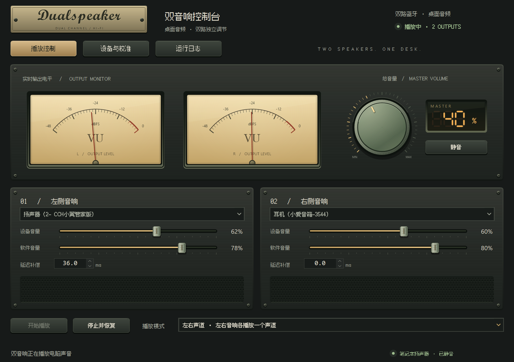
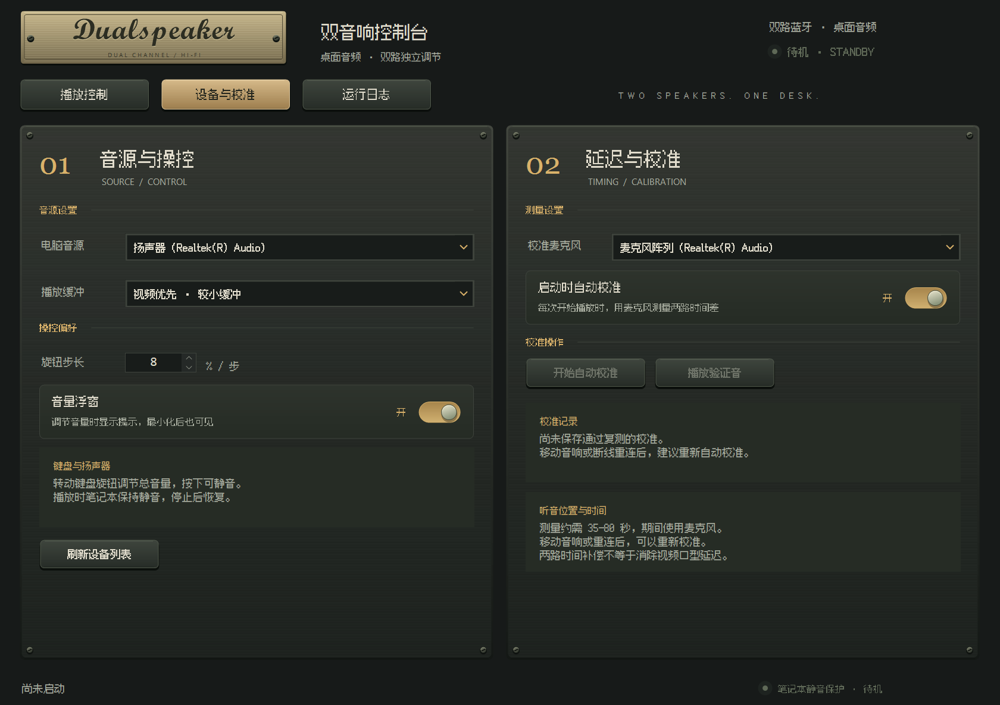
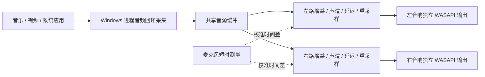

<div align="center">


# DualSpeaker · 双音响控制台

**让两台不同品牌的蓝牙音响，一起播放电脑声音。**

A retro-styled, dual-output audio router for Windows 11.

[](#运行要求)
[](#从源码编译)
[](LICENSE)
[](https://github.com/erdongshuiyang/DualSpeaker/actions/workflows/build.yml)

[下载便携版](https://github.com/erdongshuiyang/DualSpeaker/releases) · [快速开始](#快速开始) · [常见问题](docs/FAQ.md) · [反馈问题](https://github.com/erdongshuiyang/DualSpeaker/issues)

</div>



## 为什么做这个项目

桌上有一台天猫精灵和一台小爱音箱，它们都能连接笔记本，却不能像同型号的立体声组合那样一起播放。Windows 的普通默认播放设置也不能直接把同一段声音分发给这两台独立设备。

DualSpeaker 从这个具体需求出发：捕获其他应用的声音，分别送往两台输出设备；既可以让两边播放完整声音，也可以指定一边播放左声道、一边播放右声道。随后加入音量旋钮、静音保护、麦克风校准和复古控制台界面，让它成为能放在桌面上日常使用的小工具。

目前是 **面向 Windows 11 的早期公开版本**。实际使用与联调主要来自一台笔记本、天猫精灵和小爱音箱的组合；其他蓝牙硬件、驱动与播放器仍需要社区验证。

## 能做什么

| 功能 | 说明 |
| --- | --- |
| 双设备同时播放 | 将电脑声音分别送往两台独立输出设备 |
| 完整立体声 / 左右分配 | 两台各播完整立体声，或分别承担左、右声道 |
| 独立输出调节 | 分别调整设备音量、软件音量与延迟补偿 |
| 键盘音量操控 | 播放期间接管标准音量键；支持旋钮步长设置与总静音 |
| 音量浮窗 | 小尺寸喇叭图标、横向音量条与百分比，不抢焦点 |
| 麦克风自动校准 | 短时录音测量两路到达时间差，补偿较快的一路并复测 |
| 系统声音恢复 | 正常停止时恢复原来的默认输出、音量与静音状态；带异常退出恢复助手 |
| 复古控制台 | 金属铭牌、暖色 VU 表、实体旋钮、点阵中文与音响网罩，支持高 DPI 和整页等比缩放 |

**同步有边界：** 两个独立蓝牙设备存在各自的内部缓存。软件可以补偿两路时间差、约束采样时钟漂移，但不能保证任意设备长期绝对同步，也不能消除蓝牙本身的音画延迟。

## 界面效果

### 播放控制

双路电平、总音量、独立设备与软件音量、延迟补偿集中在一个页面。上方大图为实际运行界面。

### 设备与校准

选择电脑音源和校准麦克风，调整播放缓冲、旋钮步长、浮窗与自动校准偏好。



### 音量浮窗

调节音量时出现在当前屏幕底部，停止操作约 1.8 秒后隐藏，最小化主窗口后仍可使用。


截图中的设备名和配置来自开发环境，仅展示界面效果。英文铭牌会根据本机可用的系统花体字体回退；中文像素字体随程序附带。

## 运行要求

- **Windows 11 x64**，完整桌面环境及 .NET Framework 4.8。
- 两台已在 Windows 中配对、连接，且能分别独立播放的音响。
- 一个可作为默认输出的内置声卡或其他**独立于这两台音响**的播放端点。
- 自动校准需要可用麦克风及 Windows 麦克风访问权限；普通播放不使用麦克风。

不需要安装虚拟声卡或新的音频驱动。当前不支持 macOS、Linux、Windows ARM64 原生版本或超过两台输出设备。Windows 10 不在本项目已验证支持范围内。

## 快速开始

1. 在 [Releases](https://github.com/erdongshuiyang/DualSpeaker/releases) 下载 `DualSpeaker-v版本号-win-x64.zip`，**完整解压到可写目录**。保留 DLL、`fonts` 与配置文件，不能只取出 EXE。
2. 在 Windows 蓝牙设置中连接两台音响，先确认每台分别能正常播放。
3. 运行 `DualSpeaker.exe`，在“播放控制”页手动选择左、右音响，确保是两台不同设备。
4. 到“设备与校准”页，把“电脑音源”设为笔记本内置声卡等独立端点，**不要选择已用作左、右输出的音响**。首次使用请检查设备选择；开发时使用的设备名称匹配并不适用于所有电脑。
5. 点击“开始播放”。如果启用了“启动时自动校准”，程序会短时录音测量，约需 35–80 秒；也可以关闭该项，先试听再手动校准。
6. 在 QQ 音乐、爱奇艺等播放器中选择“系统默认”输出，开始播放音乐或视频。
7. 选择“两台都播放完整立体声”或“左右声道”模式；用总音量或键盘旋钮控制两台音响。
8. 结束时点击“停止并恢复”，或关闭程序，恢复启动前的声音设置。

程序需要持续运行才能分发声音，当前不自动设置开机启动。运行时会把选定的电脑音源端点保持静音，避免笔记本与蓝牙重复出声；**Windows 原生音量显示为 0 或静音是这一机制的一部分**。播放时音量键控制的是 DualSpeaker 的总音量，以软件与浮窗显示为准。

### 校准建议

把麦克风放在日常听音位置，保证能同时听清两台音响，点击“开始自动校准”。软件通过测试信号识别两路到达时间差、为较快的一路增加延迟，并重新录音复测。

“校准通过”要求复测符合程序的残差阈值，代表本次连接与当前位置的短时测量结果。移动音响、断线重连、电脑休眠或听到明显回声后，应重新校准。两台音箱的音色与响度差异仍需分别调整。

### 看电影之前

两台音响之间同步，并不代表声音与画面同步。软件无法把尚未捕获的声音提前发出，也没有接管爱奇艺的画面时间轴。支持音画偏移调整的本地播放器可单独补偿；对缺少该功能的流媒体播放器，仍可能听到声音落后于画面。

## 从源码编译

在 **Windows 11 x64** 上打开 Windows PowerShell 5.1：

```powershell
git clone https://github.com/erdongshuiyang/DualSpeaker.git
cd DualSpeaker
powershell -NoProfile -ExecutionPolicy Bypass -File .\build.ps1
```

编译使用 Windows 自带的 .NET Framework C# 编译器，不需要安装 .NET SDK 或 Visual Studio。首次编译会从 NuGet 下载固定版本的 NAudio 2.2.1，并检查包的 SHA-256；需要网络访问 `api.nuget.org`。输出位于 `dist/DualSpeaker/`。

```powershell
# 不访问麦克风、不播放测试音的纯算法检查
.\dist\DualSpeaker\DualSpeaker.Cli.exe --selftest
.\dist\DualSpeaker\DualSpeaker.Cli.exe --volume-selftest

# 生成不含设备配置、日志与录音的便携包
.\scripts\package-release.ps1 -Version 0.1.0
```

打包结果与 SHA-256 文件位于 `artifacts/`。GitHub Actions 会编译项目、运行这两项检查并上传便携包；这些检查不代表真实蓝牙硬件兼容性测试。

## 工作原理



采集接口排除本程序进程树，避免重新捕获自己输出的声音。两路用独立输出流读取同一音源缓冲，按配置应用增益、声道和延迟，并用轻微重采样约束缓冲漂移。

针对本机爱奇艺播放时右音响偶发无声的问题，播放期间还维持一个完全静音的 Windows 媒体会话；停止时释放。这是已在开发环境验证有效的兼容处理，并非对所有播放器的通用保证。

架构与模块见 [docs/ARCHITECTURE.md](docs/ARCHITECTURE.md)。

## 已知限制与隐私

- 蓝牙音箱内部缓存不受程序控制，连接稳定性和整体延迟受适配器、驱动、设备与播放器影响。
- 严格左右声道隔离取决于上游音频；系统环绕、Nahimic 等混音效果可能已经改变原始左右声道。
- 独占或受保护的音频流可能无法由系统接口捕获。
- 默认“视频优先”使用 120 ms 音源缓冲与 60 ms 请求输出缓冲；这些是配置值，**不是实测总延迟**。
- 平时播放不打开麦克风。手动校准或启动自动校准会把录音保存到程序目录的 `diagnostics/`，可以自行删除。
- 当前应用代码没有联网、遥测或云端上传功能；构建时的依赖下载与 GitHub 操作不属于运行时功能。
- `settings.json`、恢复记录与日志保存在程序目录，可能含设备标识。Git 与发布脚本默认排除这些文件；反馈问题前仍应检查所附资料。
- 版本尚未进行代码签名，源代码、构建流程与便携包校验文件均公开。

没有声音、笔记本重复出声、单侧无声、异常退出恢复等问题，请先看 [常见问题](docs/FAQ.md)。

## 参与改进

欢迎提交 [Issue](https://github.com/erdongshuiyang/DualSpeaker/issues) 或 Pull Request。尤其欢迎不同音箱组合的兼容反馈、蓝牙重连与休眠恢复问题，以及在真实硬件上有明确测量依据的音频优化。

开发与验证约定见 [CONTRIBUTING.md](CONTRIBUTING.md)。当前没有承诺的发布周期或跨设备同步精度；提交反馈时请描述硬件、系统、播放器、预期与实际结果。

## 许可证与致谢

本项目代码使用 [MIT License](LICENSE)。感谢 [NAudio](https://github.com/naudio/NAudio)、[Microsoft Windows audio samples](https://github.com/microsoft/Windows-classic-samples/tree/main/Samples/ApplicationLoopback) 和 [Fusion Pixel Font](https://github.com/TakWolf/fusion-pixel-font)。字体采用 SIL OFL 1.1；第三方版权与随附声明见 [THIRD-PARTY-NOTICES.md](THIRD-PARTY-NOTICES.md)。

项目与天猫精灵、小米、QQ 音乐或爱奇艺没有隶属或官方合作关系。产品名仅用于说明开发背景与实际使用场景。
